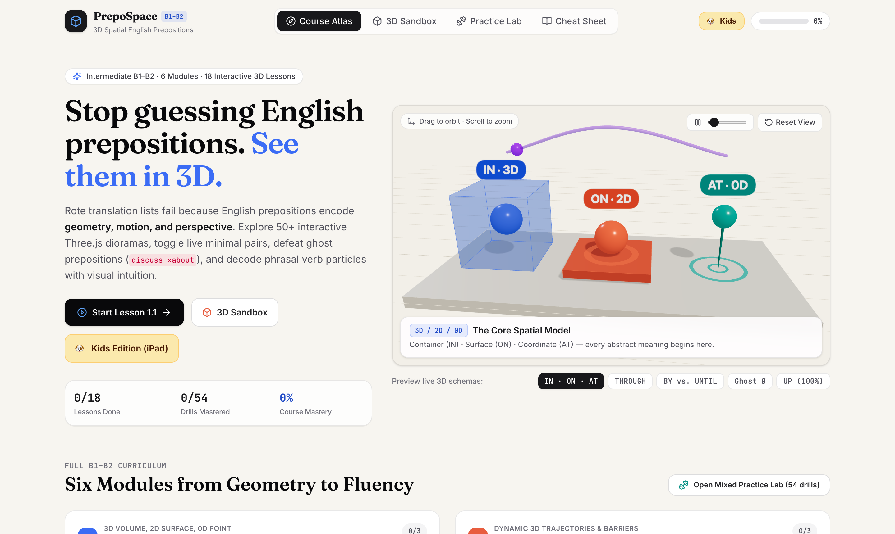
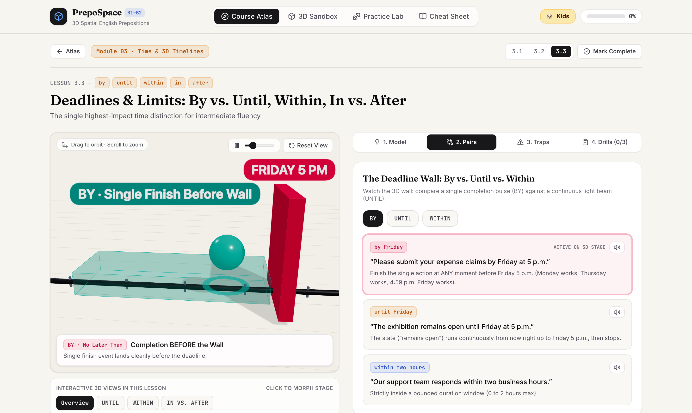
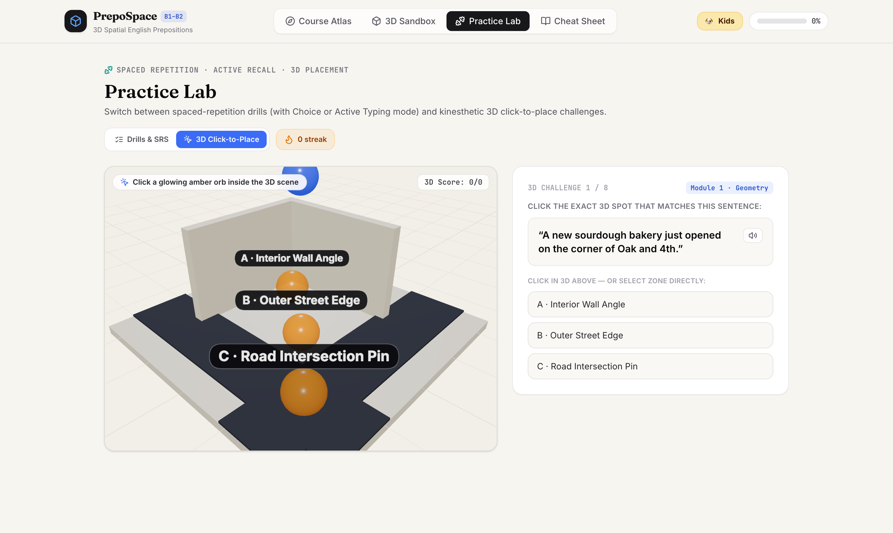
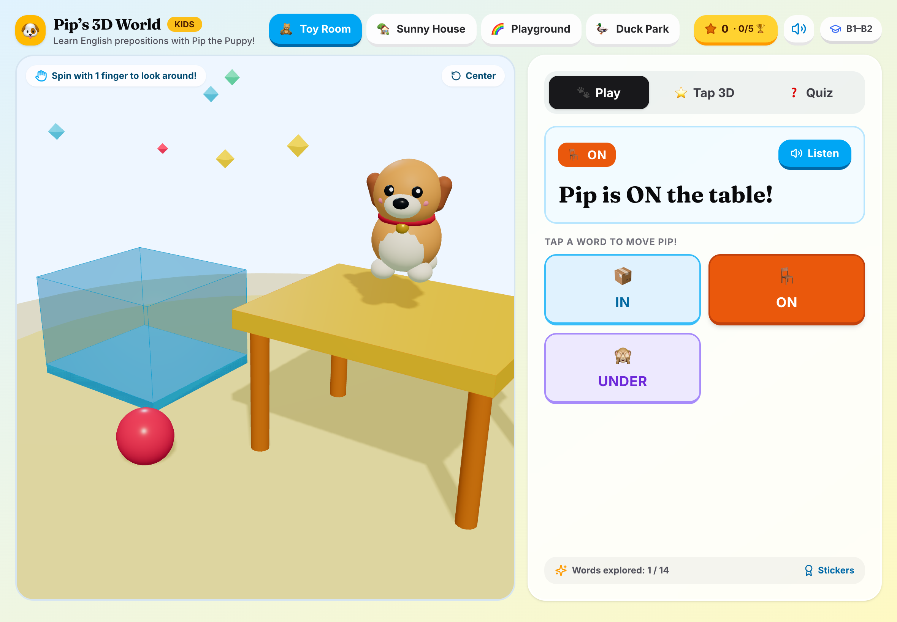
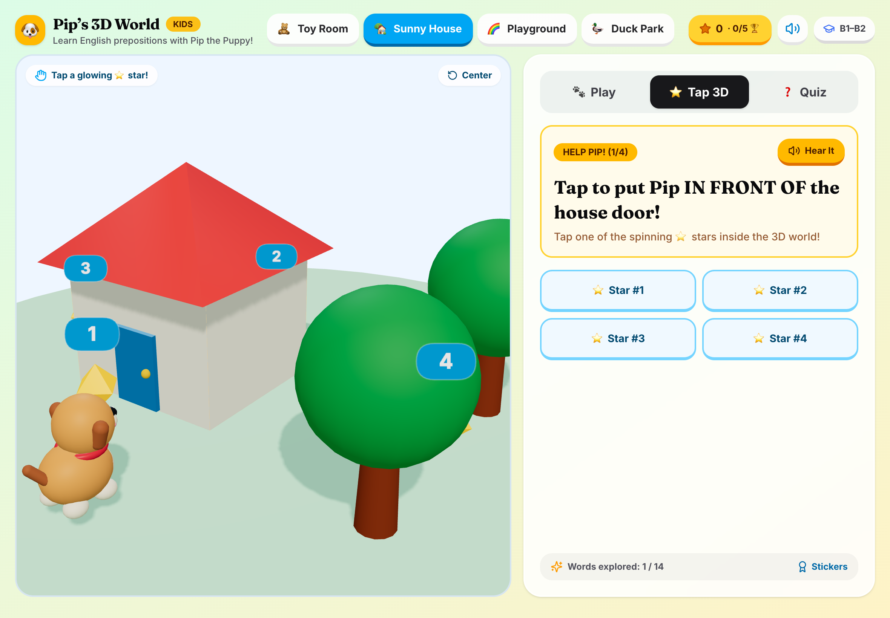
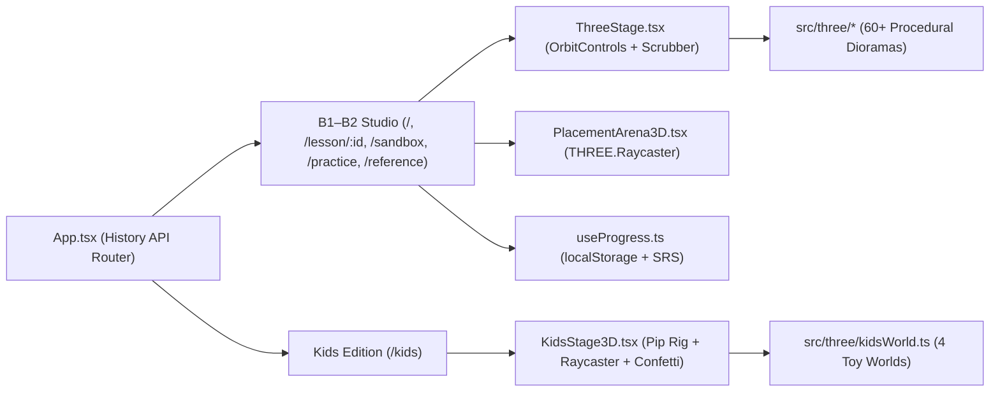

<div align="center">

# PrepoSpace

**Stop memorizing English prepositions. See them in 3D.**

An interactive Three.js web application for learning English prepositions through 3D spatial intuition, live minimal pairs, kinesthetic raycast placement, and spaced repetition — featuring both an **Intermediate B1–B2 Studio** and an **iPad-first Kids Edition**.

[](https://react.dev/)
[](https://www.typescriptlang.org/)
[](https://threejs.org/)
[](https://tailwindcss.com/)
[](Dockerfile)
[](LICENSE)

**Live Demo:** [prepospace.aurorabounce.com](https://prepospace.aurorabounce.com) &nbsp;·&nbsp; **Kids Edition (iPad):** [prepospace.aurorabounce.com/kids](https://prepospace.aurorabounce.com/kids)

<br />



</div>

---

## Screenshots

### Intermediate B1–B2 Studio

<table>
  <tr>
    <td width="50%">
      
      <p align="center"><strong>Split-Stage Lesson Studio</strong> — Live-morphing 3D Deadline Wall (<code>by</code> vs. <code>until</code> vs. <code>within</code>) with minimal pairs, audio playback, and animation scrubbing.</p>
    </td>
    <td width="50%">
      
      <p align="center"><strong>3D Click-to-Place Arena</strong> — Interactive <code>THREE.Raycaster</code> challenges where learners click directly inside 3D dioramas to match spatial sentences.</p>
    </td>
  </tr>
</table>

### Kids Edition — Pip’s 3D World (`/kids`, iPad-First)

<table>
  <tr>
    <td width="50%">
      
      <p align="center"><strong>Play with Pip (iPad Landscape)</strong> — Tap chunky word tiles to make Pip leap <code>in</code>, <code>on</code>, or <code>under</code> with spoken audio and 3D star confetti.</p>
    </td>
    <td width="50%">
      
      <p align="center"><strong>Tap 3D Hide &amp; Seek</strong> — Spin the 3D world with one finger and tap the glowing star to help Pip find <code>in front of</code>, <code>behind</code>, <code>next to</code>, and <code>between</code>.</p>
    </td>
  </tr>
</table>

---

## Why PrepoSpace?

Traditional preposition courses fail because they teach **word-for-word translation lists** (*"`on` has 18 meanings"*). Prepositions rarely map 1-to-1 across languages—what English actually encodes is **geometry, motion, perspective, and metaphor**:

- **`in`** = 3D container or volume (*in a room*, *in a taxi*, *in an email*, *in debt*)
- **`on`** = 2D surface, walkable platform, or 1D line (*on the street corner*, *on a bus*, *on Zoom*, *on strike*)
- **`at`** = 0D coordinate, workstation, or threshold (*at the desk*, *at the hospital*, *at risk*)

PrepoSpace turns those hidden mental models into **60+ live, orbitable Three.js dioramas** so learners build real visual intuition rather than guessing.

---

## Two Complete Editions in One App

| Edition | Route | Audience | Highlights |
| :--- | :--- | :--- | :--- |
| **PrepoSpace Studio** | `/` | Intermediate (B1–B2) international learners | 6 modules, 18 lessons, 60+ 3D scenes, live-morphing minimal pairs, 54 SRS drills, active typing mode, 3D Click-to-Place arena, searchable cheat sheet |
| **Pip’s 3D World (Kids)** | `/kids` | Children (ages 5–10) · optimized for iPad | Animated 3D puppy (*Pip*) across 4 colorful toy worlds, 14 core prepositions, giant touch targets, spoken voice + gentle chimes, Tap-in-3D hide-and-seek, star sticker book |

---

## Intermediate Curriculum (B1–B2)

Every lesson follows a repeatable 4-step studio loop paired with a sticky interactive 3D stage (**1. Mental Model → 2. Live-Morphing Minimal Pairs → 3. Common Traps → 4. Active Practice Drills**):

| # | Module | Focus | Key Distinctions |
| :-: | :--- | :--- | :--- |
| **01** | **The Big Three: `in`, `on`, `at`** | 3D / 2D / 0D geometry, transport, institutions, digital media & abstract states | *in/on/at the corner*, *in a car* vs. *on a bus*, *on Zoom* vs. *in an email* |
| **02** | **Motion, Paths & Boundaries** | Dynamic entry/exit, traversal geometry, vectors & verticality | *into/onto/out of/off*, *through* vs. *across* vs. *along*, *over* vs. *above*, *under* vs. *below* |
| **03** | **Time & 3D Timelines** | Clock/day/month geometry, zero-prep time, durations & deadlines | *`Ø` next/last/this/every*, *for* vs. *since* vs. *during*, ***by* vs. *until***, *in* vs. *after* |
| **04** | **High-Confusion Pairs & Nuance** | Subtle meaning shifts that mark B2 fluency | *to* vs. *for*, *made of* vs. *made from*, *with* vs. *by*, *between* (3+ named items!) vs. *among*, *like* vs. *as* |
| **05** | **Collocation Chunks & Ghost Prepositions** | Semantic `Verb/Adj + Prep` families, zero-prep traps & missing-prep circuits | *depend on*, *familiar with/to*, *discuss ~~about~~*, *marry ~~with~~*, *explain **to** me* |
| **06** | **Particle Logic (Phrasal Verbs)** | Spatial forces behind common phrasal verb particles | *up* (100% completion), *down* (reduce/record), *out* (reveal/exhaust), *in*, *off*, *on*, *over*, *through* |

### Interactive Studio Features
- **Play / Pause & Timeline Scrubber:** Freeze animated 3D trajectories (*through*, *into*, *by vs. until*, *discuss Ø*) mid-flight and orbit around them from any angle.
- **3D Click-to-Place Arena (`THREE.Raycaster`):** Click directly inside 3D dioramas to place the orb in the exact spatial zone matching a sentence.
- **Active Recall Typing Mode + Spaced Repetition (SRS):** Toggle off multiple choice to type prepositions directly (including `Ø`/`none` for ghost prepositions), with automatic interval scheduling (`1d → 3d → 7d → 14d`) and a **Due for Review** queue stored in `localStorage`.
- **Spoken English Audio:** One-click natural Web Speech API playback on minimal pairs, traps, sandbox examples, and challenges.
- **100% Offline / Self-Hosted Assets:** Fonts (`Fraunces`, `Inter`, `JetBrains Mono`) are bundled via `@fontsource` with zero external CDN requests.

---

## Kids Edition — Pip’s 3D World (`/kids`)

Designed from the ground up for **iPad landscape and portrait touch** (single-viewport zero-scroll layout, `touch-action: none` on 3D stages, large chunky pressable buttons, and Apple Home Screen PWA meta tags):

| World | Prepositions | 3D Toy Props |
| :--- | :--- | :--- |
| **🧸 Toy Room** | `in`, `on`, `under` | Translucent sky-blue toy box, sunny wooden table, toy ball |
| **🏡 Sunny House** | `in front of`, `behind`, `next to`, `between` | Red-roofed playhouse with front door, two apple trees |
| **🌈 Playground** | `into`, `out of`, `over`, `through` | Magic box, rainbow hurdle fence, striped playground tunnel |
| **🦆 Duck Park** | `up`, `down`, `around` | Green stepping hill, yellow slide, duck pond with floating rubber duck |

- **🐾 Play:** Tap a word tile — Pip hops or runs there in 3D and reads the sentence aloud.
- **⭐ Tap 3D:** Hide-and-seek raycasting — spin the 3D world with one finger and tap the glowing star in the right spot for a 3D star-confetti burst and chime.
- **❓ Quiz:** Find where Pip is hiding in 3D and pick the matching word to collect stars and unlock 5 badges in **My Sticker Book**.

> **iPad Tip:** Open `/kids` in Safari on iPad and tap **Share → Add to Home Screen** to run it fullscreen like a native app.

---

## Architecture Overview



---

## Quick Start

### Local Development

```bash
npm install
npm run dev
```

Open `http://localhost:5173` (or `http://localhost:5173/kids` for Kids Edition).

### Production Build

```bash
npm run build
npm run preview
```

### Run with Docker

```bash
docker compose up -d --build
```

The multi-stage [Dockerfile](Dockerfile) builds with `node:22-alpine` and serves static assets via a hardened, non-root, read-only `nginx:alpine` container on `http://localhost:8080` with SPA fallback routing, gzip compression, immutable asset caching, and a `/healthz` endpoint.

For TLS termination behind a reverse proxy, see [deploy/nginx.example.conf](deploy/nginx.example.conf).

---

## Project Structure

```text
├── Dockerfile                 # Multi-stage Node -> non-root Nginx SPA image
├── compose.yaml               # Hardened Docker Compose config (read_only, cap_drop: ALL)
├── docker/nginx.conf          # Non-root Nginx SPA config (/healthz + immutable /assets)
├── deploy/nginx.example.conf  # Example HTTPS reverse-proxy vhost
└── src/
    ├── components/            # Atlas, LessonStudio, ThreeStage, PlacementArena3D, PracticeLab, KidsApp, KidsStage3D
    ├── data/                  # 6 B1–B2 modules, 8 raycast challenges, 4 Kids toy worlds, sandbox & cheat sheet
    ├── hooks/                 # localStorage persistence & spaced repetition (SRS)
    ├── three/                 # Procedural Three.js scene builders + Pip the Puppy rig
    ├── types/                 # Shared TypeScript curriculum & scene contracts
    └── utils/                 # Web Speech API pronunciation & Web Audio API chimes
```

---

## License

Released under the [MIT License](LICENSE).
